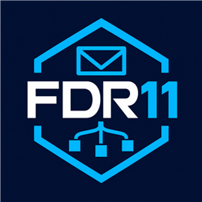

# FDR11.Notifications.Email

Libreria .NET 10 per inviare email tramite SMTP, SendGrid, Amazon SES e Azure Communication Services, con retry, logging, metriche e tracing.

- [Documentazione, configurazione ed esempi](Code/README.md)
- [CI e pubblicazione NuGet](RELEASING.md)

Il pacchetto NuGet include l'icona e il README completo di `Code/README.md`.
